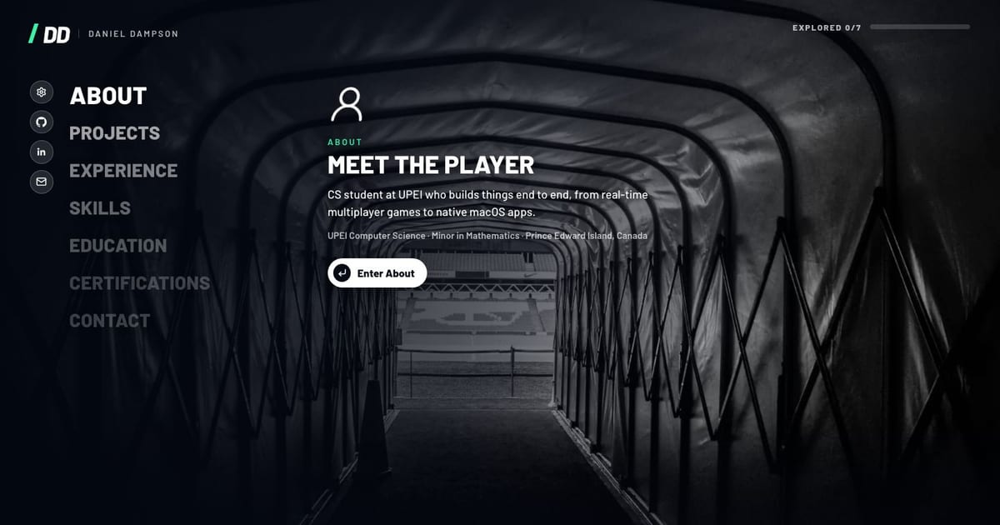

# Daniel Dampson | Portfolio

**Live:** https://www.abeikud.com

My portfolio, styled like a football game's main menu. A stadium scene fills the
screen, a big vertical menu fades away from the selected item, and a preview panel
changes as you move through it. Each menu item opens its own screen, and the tiles
on those screens open further detail.

## Controls

On a **computer, the site is played with the keyboard**, like a console. The mouse is
ignored and its pointer is hidden; the wheel still scrolls long pages. The key hints
along the bottom of each screen show the controls. **Phones and tablets** use taps instead: tap once to select, and again to
open.

|                  | Keys                                                                     |
| ---------------- | ------------------------------------------------------------------------ |
| Move             | ↑ ↓ in the menu; arrows or WASD on tiles                                 |
| Open / select    | Enter                                                                    |
| Back             | Esc or Backspace                                                         |
| Switch tabs      | Q / E (like LB / RB)                                                     |
| Links & settings | ← from the menu into the icon rail; ↑ ↓ inside it; → or Esc to return    |
| Everything else  | Tab reaches every link, such as news items, contact cards and the resume |

Back always returns you to the item you came from. An **EXPLORED n/7** bar tracks
the sections you've visited, and visiting all seven completes the season objective.
**Settings** (the gear) has a Reduce motion switch, and the site also respects the
operating system's reduced-motion setting.

## Built with

React 19 · TypeScript · Vite · React Router · CSS Modules · Vitest + Testing Library ·
Playwright (Chromium, plus WebKit on an iPhone profile) · axe-core · GitHub Actions ·
Vercel

## How it was built

Test-first, in reviewable phases, with one PR per phase (see
[`docs/PLAN.md`](docs/PLAN.md)). In each PR the commit history shows the failing tests
first, then the code that makes them pass.

| Phase | What                                             | PR                                                  |
| ----- | ------------------------------------------------ | --------------------------------------------------- |
| 0     | Tooling, test harness, CI/CD                     | [#13](https://github.com/Abeikud/portfolio/pull/13) |
| 1     | Resume as typed content                          | [#14](https://github.com/Abeikud/portfolio/pull/14) |
| 2     | Menu navigation logic                            | [#15](https://github.com/Abeikud/portfolio/pull/15) |
| 3     | Main menu layout and theme                       | [#16](https://github.com/Abeikud/portfolio/pull/16) |
| 4     | Preview panel and stadium scenes                 | [#17](https://github.com/Abeikud/portfolio/pull/17) |
| 5     | Routing, transitions, screen shell               | [#18](https://github.com/Abeikud/portfolio/pull/18) |
| 6     | Hub components and Projects                      | [#19](https://github.com/Abeikud/portfolio/pull/19) |
| 7     | Experience, Education, Certifications            | [#20](https://github.com/Abeikud/portfolio/pull/20) |
| 8     | About, Skills, Contact                           | [#21](https://github.com/Abeikud/portfolio/pull/21) |
| 9     | HUD and polish                                   | [#22](https://github.com/Abeikud/portfolio/pull/22) |
| 11    | Accessibility, layout, metadata, budgets, launch | (this phase)                                        |

The optional Phase 10 (a Three.js scene layer) was left out of v1. See
[#11](https://github.com/Abeikud/portfolio/issues/11).

### What CI checks on every PR

- Typecheck, lint (including jsx-a11y) and formatting
- About 290 unit and component tests, with an 80% coverage gate
- Playwright end-to-end tests against the production build, on desktop Chrome, a
  Pixel 7 and an iPhone 13 (WebKit). They include:
  - **axe**: no serious or critical WCAG 2.2 AA issues on any route
  - **no sideways scrolling** on any route at 390, 768 and 1440 px
  - a **keyboard-only tour** of the whole site
- **Size budgets**: entry JS under 130 KB gzipped, each scene photo under 300 KB,
  favicon SVG under 4 KB
- **Privacy**: tests fail if a phone number appears anywhere in the content or
  the rendered pages

## Editing the content

Everything on the site comes from [`src/content/resume.ts`](src/content/resume.ts),
with the menu copy in [`src/content/sections.ts`](src/content/sections.ts). Tests
check the content's shape, for example newest-first roles, unique slugs, no
duplicate skills and no placeholder copy.

**Resume:** `public/DDAMPSON_RESUME.pdf`, linked from `resume.contact.resumePdf`.
It opens in a new tab in the browser's PDF viewer. To update it, replace the file and
keep the name, or change `resumePdf`.

**Icons:** the "D." monogram (white letters with a solid 3D extrusion on a charcoal
tile) is drawn from the site's Barlow ExtraBold outlines in
[`scripts/icons.mjs`](scripts/icons.mjs). `npm run icons` rebuilds `favicon.svg`, the
16/32 px PNGs, `favicon.ico`, the 180 px Apple touch icon and the manifest icons
(`site.webmanifest`) in `public/`. Tests check every size, that the touch icon is
opaque, and that the maskable icon stays inside Android's safe zone.

**Stadium photos:** these are freely licensed images from Wikimedia Commons, listed in
[`src/content/scenes.json`](src/content/scenes.json) and credited on screen and in
[`docs/CREDITS.md`](docs/CREDITS.md). `npm run scenes` regenerates the WebP
versions.

## Deploying

The site is hosted on **Vercel** at **[www.abeikud.com](https://www.abeikud.com)**
(`abeikud.com` redirects there).

- Every merge to `main` deploys to production automatically, and every PR gets its
  own preview URL.
- [`vercel.json`](vercel.json) sets the Vite build, the deep-link rewrite and asset
  caching. Node 24 comes from `engines`.
- [`config/deploy.ts`](config/deploy.ts) makes the canonical and Open Graph URLs
  `https://www.abeikud.com/`. `SITE_URL` and `BASE_PATH` override them if needed.

**The old address** `abeikud.github.io/portfolio` no longer hosts a copy. GitHub
Pages serves [`pages-redirect/index.html`](pages-redirect/index.html) (built by
`.github/workflows/deploy.yml`), which forwards every old link to the same page on
www.abeikud.com. For example, `/portfolio/projects/startingfive` goes to
`/projects/startingfive`.

CI tests the app served from `/`, and the `pages` Playwright project checks the
redirect.

## Scripts

| Command               | What it does                                     |
| --------------------- | ------------------------------------------------ |
| `npm run dev`         | Start the dev server                             |
| `npm test`            | Unit and component tests (Vitest)                |
| `npm run test:e2e`    | End-to-end tests (Playwright, production build)  |
| `npm run budgets`     | Check build sizes (after a build)                |
| `npm run check`       | Everything CI runs                               |
| `npm run scenes`      | Download and optimise the scene photos           |
| `npm run icons`       | Rebuild the favicon and home-screen icons        |
| `npm run screenshots` | Capture review screenshots (`SCREENSHOTS_DIR=…`) |
| `npm run build`       | Production build to `dist/`                      |

The layout and feel are inspired by a football video game's main menu. All branding,
copy and imagery are original or openly licensed. No game logos, fonts or
screenshots are used.
